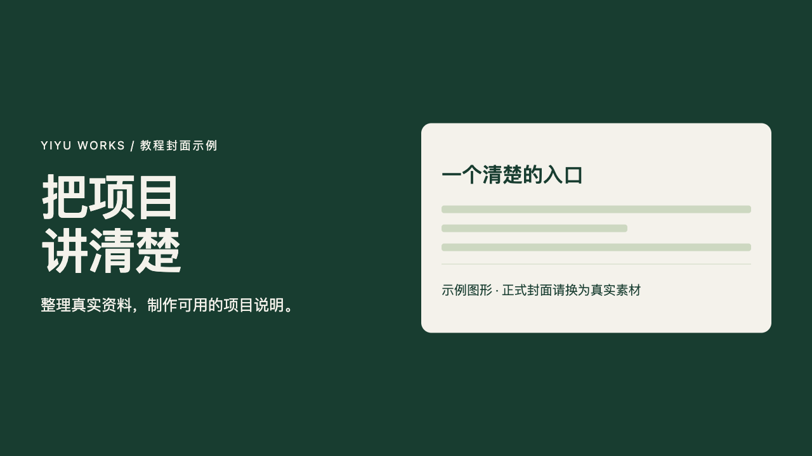
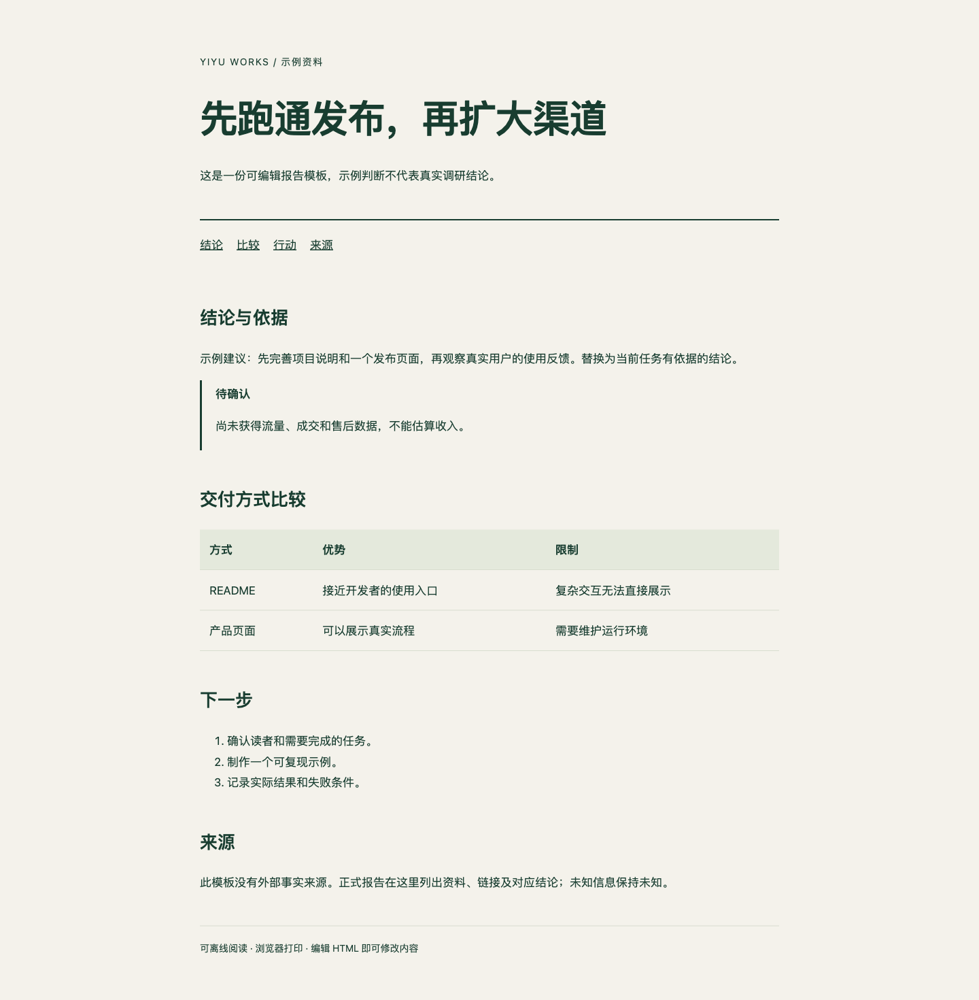

# Yiyu Works · Skills

把经验写成工作流，把想法做成作品。

十个免费 Agent Skills，围绕项目表达、产品界面和内容交付。**0.1.0 实验版**：流程、模板与本地辅助工具已提供，模型效果尚未完成跨宿主评测。不是 oil-oil 的官方项目，也不是其 Pro 版本。

| Skill | 用途 | 资源 |
|---|---|---|
| [readme-polish](skills/readme-polish) | 项目 README 整理 | [示例](examples/readme-polish) · [验收](evaluations/readme-polish/cases.md) |
| [ui-design](skills/ui-design) | 界面设计与探索 | [示例](examples/ui-design) · [验收](evaluations/ui-design/cases.md) |
| [frontend-check](skills/frontend-check) | 前端状态与交互检查 | [示例](examples/frontend-check) · [验收](evaluations/frontend-check/cases.md) |
| [clear-writing](skills/clear-writing) | 清晰产品文案 | [示例](examples/clear-writing) · [验收](evaluations/clear-writing/cases.md) |
| [html-report](skills/html-report) | 单页 HTML 报告 | [示例](examples/html-report) · [验收](evaluations/html-report/cases.md) |
| [web-slides](skills/web-slides) | 可编辑网页演示 | [示例](examples/web-slides) · [验收](evaluations/web-slides/cases.md) |
| [web-motion](skills/web-motion) | 网页交互动效 | [示例](examples/web-motion) · [验收](evaluations/web-motion/cases.md) |
| [icon-set](skills/icon-set) | 统一风格图标集 | [示例](examples/icon-set) · [验收](evaluations/icon-set/cases.md) |
| [cover-maker](skills/cover-maker) | 真实内容封面 | [示例](examples/cover-maker) · [验收](evaluations/cover-maker/cases.md) |
| [video-to-article](skills/video-to-article) | 视频转图文文章 | [示例](examples/video-to-article) · [验收](evaluations/video-to-article/cases.md) |

## 模板预览

以下为本库原创模板的实际浏览器截图，不代表模型在其他项目上的生成效果。





## 安装

选择需要的技能，不必安装全部：

```bash
npx skills add yiyu-works/skills --skill readme-polish
```

首次使用会由包管理器下载第三方安装工具。也可手动复制单个完整技能目录。详细步骤与依赖见 [安装说明](docs/installation.md) 和 [兼容范围](docs/compatibility.md)。

```text
使用 $readme-polish 整理当前仓库 README，核对事实与安装步骤。
```

## 能力与边界

技能需要宿主Agent负责读写文件、调用工具和理解内容。图片生成、视觉检查、浏览器和转录能力取决于宿主；本库不提供模型服务，也不会自动配置密钥或发布内容。

- [验证记录](evaluations/RESULTS.md)：区分脚本检查、模板浏览器检查与未完成的效果评测。
- [来源说明](THIRD_PARTY_NOTICES.md)：研究参考与许可边界。
- [反馈与贡献](CONTRIBUTING.md) · [维护政策](docs/support-policy.md)

原创代码与文档采用 [MIT](LICENSE)。用户输入、外部素材和生成服务受各自许可约束。
